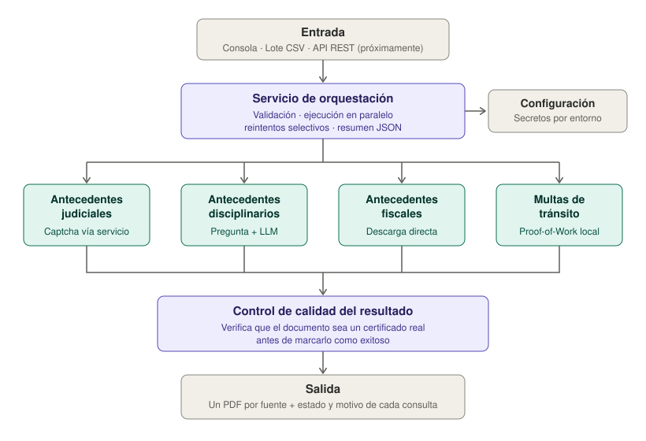

# Orquestador de consultas de antecedentes


Plataforma en Python que consulta en paralelo varias fuentes públicas de antecedentes
(judiciales, disciplinarios, fiscales y multas de tránsito), devuelve **un PDF por fuente**
y **verifica que cada documento sea realmente un certificado** antes de darlo por bueno.

> **Este repositorio es la versión pública.** Contiene el núcleo completo (orquestación,
> reintentos, control de calidad, procesamiento por lotes, tests y CI) con **fuentes de
> demostración** que simulan los portales. Las integraciones con los portales reales están
> en un repositorio privado y cumplen la misma interfaz. Puedo mostrarlas en una entrevista.

---

## El problema

En una empresa de selección de personal, dos personas armaban a mano los informes de
antecedentes de cada candidato: entrar en cuatro portales distintos, resolver sus
verificaciones, descargar cada certificado y revisarlo. El volumen habitual era de más de
1.000 solicitudes.

## La solución

```
python main.py --cedula 1234567890 --fuentes judicial fiscal
```

- **Eliges las fuentes** (una, varias o `todas`) y recibes un PDF por cada una, más un `resumen.json`.
- **Consulta en paralelo**: el tiempo total es el de la fuente más lenta, no la suma.
- **Reintenta solo lo que tiene sentido**: una caída pasajera o un captcha caducado se reintentan;
  un formulario que cambió, no (reintentar no lo arreglaría y gastaría recursos).
- **Control de calidad**: si el portal devuelve una página genérica en lugar del certificado,
  la consulta se marca `RESPUESTA_RECHAZADA` y no `EXITOSO`.
- **Por lotes**: `python lote.py personas.csv` procesa un CSV (separador y codificación de Excel
  detectados solos) y deja un `resultados.csv` con el estado y el motivo de cada fuente.

## Resultados con los portales reales

Ejecuciones reales del 19/11/2026, una fuente por ejecución ([salida completa](docs/ejemplo_consola.txt)):

| Fuente | Tiempo | Intentos | Nota |
|---|---|---|---|
| Fiscal | 1,4 s | 1 | Descarga directa del PDF oficial |
| Disciplinaria | 4,0 s | 1 | Pregunta de verificación resuelta por código, sin llamar al LLM |
| Judicial | 17,6 s | 1 | 14,6 s de esos son la resolución del captcha |
| Tránsito | 57,1 s | 2 | El primer intento encontró el portal caído; el reintento lo resolvió |

**Dos bugs del sistema anterior que encontré y corregí durante la migración:**

1. **Falsos positivos.** Con una respuesta incorrecta a la pregunta de verificación, el portal
   devuelve una página genérica, y el sistema anterior la entregaba como certificado `EXITOSO`.
   Lo reproduje respondiendo mal a propósito y añadí la validación que lo detecta
   ([`contiene_certificado`](consultas/demo.py)).
2. **Información perdida.** El generador de uno de los PDF solo conservaba la línea de resultado
   si empezaba por "NO TIENE…". Cualquier otro resultado se descartaba en silencio. Ahora se
   conservan todas las líneas del bloque de resultado.

Del histórico de 341 consultas del sistema anterior: la fuente disciplinaria daba un 28 % de caídas
y la judicial un 23 % de captchas caducados (por esperar la solución una sola vez). Esos son
los casos que ahora cubren los reintentos.

## Arquitectura



```
main.py / lote.py        Entrada: una cédula o un CSV (próximamente: API REST)
   └── servicio.py       Valida, consulta en paralelo, reintenta y escribe resumen.json
        ├── config.py    Toda la configuración y los secretos, por variables de entorno
        └── consultas/   Registro de fuentes: todas cumplen consultar(cedula, carpeta, nombre)
             └── demo.py Fuentes simuladas (latencia, caídas, respuestas genéricas)
```

**Decisiones técnicas**

| Decisión | Por qué |
|---|---|
| Una interfaz común para todas las fuentes | Añadir una fuente nueva es crear un módulo y registrarlo; el orquestador no cambia |
| `ThreadPoolExecutor` en lugar de `asyncio` | Las fuentes reales usan librerías síncronas; con hilos se paralelizan sin reescribirlas |
| Estados explícitos (`PAGINA_CAIDA`, `FORMULARIO_CAMBIADO`, …) en lugar de excepciones | Cada fallo se puede clasificar como reintentable o no, y el usuario recibe un motivo claro |
| Ninguna fuente puede tumbar a las demás | Si una lanza una excepción, se captura y las otras siguen |
| Secretos solo por entorno (`.env` en local, variables en la nube) | Ninguna clave en el código ni en el historial de Git |
| Carpeta de salida única por consulta | Dos consultas de la misma cédula en el mismo segundo no se pisan |

## Pruébalo

```bash
git clone https://github.com/Fackar-ai/orquestador-consultas.git
cd orquestador-consultas
python -m venv .venv && source .venv/bin/activate     # Windows: .venv\Scripts\activate
pip install -r requirements.txt

python main.py --cedula 1000000001 --fuentes todas --nombre "NOMBRE APELLIDO"
python lote.py ejemplos/lote_ejemplo.csv --fuentes judicial fiscal
```

Las fuentes demo fallan a propósito un 20 % de las veces para mostrar los reintentos y el control
de calidad. Se ajusta con `DEMO_PROB_FALLO` y `DEMO_FACTOR_LATENCIA` (ver `.env.example`).

**Tests**

```bash
pip install -r requirements-dev.txt
pytest -q        # 24 tests: validaciones, reintentos, paralelismo, control de calidad, lotes
```

## Próximos pasos

- [ ] API REST con FastAPI
- [ ] Contenedor Docker y despliegue en **Azure Container Apps**
- [ ] Cola de trabajos y almacenamiento de PDF en Azure Blob Storage

## Stack

Python 3.11+ · concurrent.futures · ReportLab · pytest · GitHub Actions ·
(privado: requests, BeautifulSoup, integración con LLM para preguntas de verificación, servicio de captcha)

---

**Alejandro Moreno**, Ingeniero Electrónico · Automatización e IA ·
[LinkedIn](www.linkedin.com/in/alejandro-moreno-87765812a)
